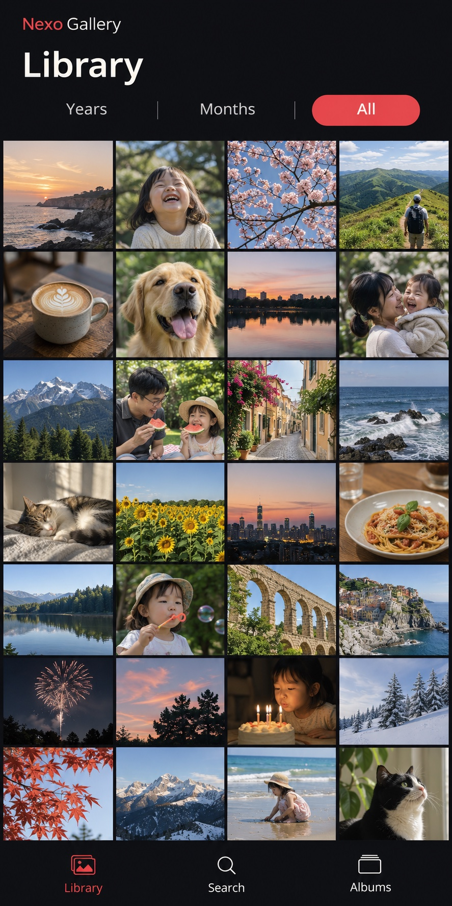
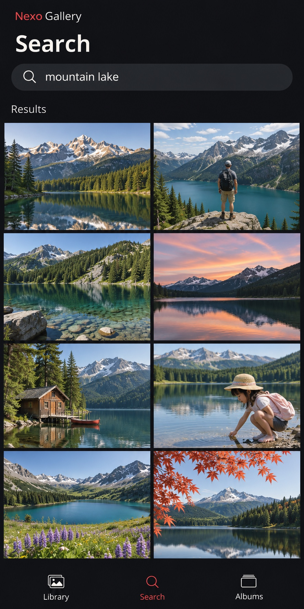

# Nexo Gallery

**Your personal media library, on storage you choose.**

Nexo Gallery is being built for people who want one beautiful place for their photos and videos without giving up control of where they live. The vision combines a familiar gallery, AI-powered search that helps you find a moment from a simple description, and the freedom to connect your own cloud or self-hosted storage. Files would be encrypted on your trusted device before upload, so a storage provider could hold them without being able to view them. Only your authorized devices would have the keys to decrypt your library.

> **In development.** The visuals below are generated design concepts, not screenshots of a released or approved product. AI search, cloud connections, authentication, media import, sync, and encryption are **not implemented in Nexo Gallery yet**. Do not add personal media to the current prototype.

## The product we are building

- **Your library, your storage.** Keep one organized media library while choosing where the encrypted files are stored. The first planned path is self-hosted, S3-compatible object storage; broader cloud connections are a product goal, not a shipping feature.
- **Find moments naturally.** Search for a place, person, date, or a description such as “the lake between the mountains.” The planned AI search runs on trusted devices so private media and search data do not need to be exposed to a storage provider.
- **Privacy you can understand.** The target design encrypts originals, previews, and sensitive library data before they leave your device. Storage providers would receive encrypted content, while authorized devices hold the keys needed to view it. Providers may still see operational metadata such as account activity, file sizes, and transfer timing. This privacy model must be verified end to end before launch.

The photo timeline, albums, search results, and video poster are sample data. Favorites last for the current page session; only the theme choice is saved. Fixture photos are loaded from Unsplash and require a network connection. The shell has no authentication, encryption, media import, persistent gallery storage, or integration with Ente/Nexo; do not put personal media into it.

The opportunity is a personal gallery that brings together the convenience people expect from a modern photo app, the ability to choose storage, and private discovery. The secure product behind this vision is the next milestone.

## Design direction

An uncluttered library should still feel effortless when it holds thousands of moments. These concept screens explore a dense photo grid and a simple search flow in the same charcoal, off-white, and coral visual system.

  
  

*Generated concepts only. They do not depict working AI search, connected storage, encryption, or the current app UI.*

## Development status

| Area | Current state |
| --- | --- |
| Gallery interface | Exploratory, unapproved prototype using sample data |
| AI-powered search | Planned; no semantic, face, or OCR search is connected |
| Bring-your-own storage | Planned; no cloud account or storage connection is available in this app |
| Client-side encryption | Architecture selected for evaluation; no encrypted import or storage is connected to this app |
| Personal media readiness | **Not ready**; backup, recovery, and security checks remain open |

The planned media foundation is [Ente's self-hosted, end-to-end encrypted stack](docs/01-foundation.md). Its [client-side encryption design](https://ente.com/architecture/) and [on-device search approach](https://ente.com/help/photos/features/search-and-discovery/machine-learning) inform the direction, but they do not prove that a Nexo Gallery integration is secure. We are testing the actual upload, storage, download, and recovery path before making that claim. See the [phase status](docs/STATUS.md), [secure-slice evidence](docs/03-secure-slice.md), and [Nexo integration contract](docs/07-nexo-integration.md) for the current gates.

## Try the interface prototype

The repository currently contains an exploratory interface shell; its design has not been approved. From the repository root, run `python3 -m http.server 4173` and open `http://localhost:4173`. Run `npm test` for the existing fixture and shell checks. There are no package dependencies.

If local ports are unavailable, run `npm run preview` and open `dist/preview.html` directly. The generated file stays out of Git. Sample photos load from Unsplash and require a network connection. The shell has no authentication, encryption, persistent storage, media import, or Ente/Nexo integration.
